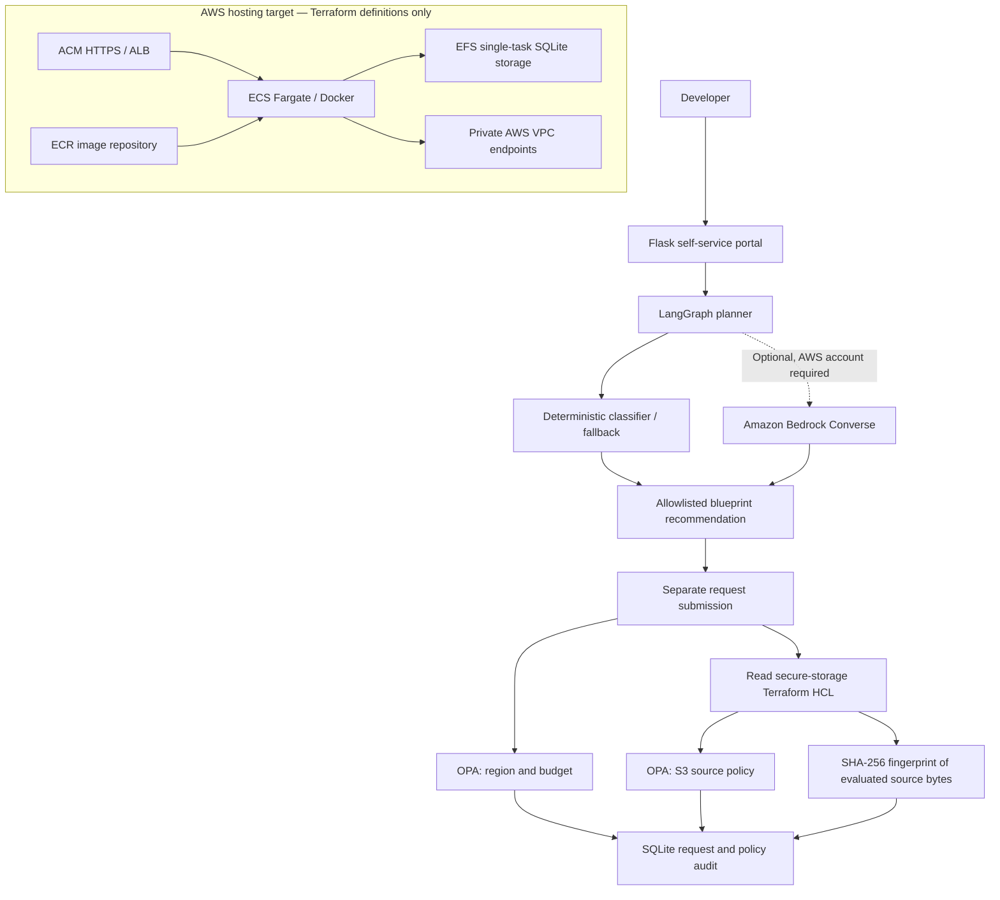

# ArchitectFlow

**Created and maintained by [Hamza Ally](https://github.com/hally)** · Cloud & Enterprise Architecture Portfolio

**An explainable, policy-governed self-service architecture portal for AWS — offline-tested prototype with AWS infrastructure defined in Terraform.**

ArchitectFlow demonstrates an enterprise platform engineering pattern: developers describe what they need; a LangGraph workflow recommends a *catalog blueprint*; Open Policy Agent (OPA) independently checks request governance and Terraform source configuration; and the portal records the results, rationale, and source fingerprint for audit.

**Release status: v1.0 portfolio prototype (not deployed to AWS).** GitHub Actions validates Python tests, OPA policies, Terraform structure and Docker container smoke tests. No AWS account, cloud resources, real Bedrock calls, or Terraform apply are required to reproduce the available tests.

[](https://github.com/hally/architectflow/actions/workflows/ci.yml)

## Why this exists

Self-service platforms must balance delivery speed and infrastructure governance. Architecture suggestions are useful, but cannot serve as security approval. ArchitectFlow separates the **advisory layer** (architecture selection) from the **deterministic enforcement layer** (OPA), while recording what evidence was evaluated.

## Architecture



The AWS hosting diagram shows **defined Terraform resources**, not an operational deployment. The Flask portal can be run locally or in the CI-tested Linux Docker image. The production hosting target uses public ALB subnets and private ECS subnets in two Availability Zones, plus optional PrivateLink endpoints.

## Built and verified

| Capability | State | Evidence |
|---|---|---|
| Flask / Jinja2 request portal | Implemented | Local browser demonstrations and container smoke tests |
| LangGraph catalog planner | Implemented | Automated Python classification tests |
| Optional Bedrock Converse classifier | Implemented adapter, **not live-tested** | Contract tests with injected fake client |
| Independent OPA request policy | Implemented | Rego tests for region/budget |
| OPA Terraform-source policy for private S3 | Implemented | Rego tests and local deliberate violation demonstration |
| Request history / architecture rationale | Implemented | SQLite, demonstrated locally |
| SHA-256 Terraform source provenance | Implemented | Local request audit and CI container smoke test |
| Secure-storage S3 Terraform module | Defined and validated | Terraform init/validate + policy checks |
| AWS platform (ALB, ECS, ECR, EFS, VPC endpoints, IAM) | Terraform defined and structurally validated | GitHub Actions Terraform checks |
| Docker packaging | Implemented | GitHub Actions builds and smoke-tests image |
| Live AWS deployment, Terraform plan/apply, runtime networking | **Not tested or implemented** | AWS account would be required |
| Serverless API blueprint provisioning | **Not implemented** | Catalog placeholder only |

**Boundary:** Terraform HCL source checks do **not** constitute a Terraform plan evaluation, AWS deployment attestation, complete security review, or permission to provision. OPA policy decisions are shown separately from architecture recommendations. No automatic provisioning is implemented.

## Reproduce the local application

Prerequisites: Python 3.13, Terraform 1.16.x, OPA v1.x (or Docker).

```powershell
python -m venv .venv
.\.venv\Scripts\Activate.ps1
python -m pip install -r requirements-app.txt
$env:OPA_EXECUTABLE = "$HOME\Tools\OPA\opa.exe"
python portal/app.py
```

Open **http://127.0.0.1:5000**.

On Linux/macOS, activate with `source .venv/bin/activate` and set `OPA_EXECUTABLE` to the installed OPA binary path. The local app stores SQLite data in Flask's instance directory. Do not use real customer data or expose the development server publicly.

### Tests without AWS credentials

```powershell
python -m unittest discover -s tests -v
& "$HOME\Tools\OPA\opa.exe" test policies/request/ -v
& "$HOME\Tools\OPA\opa.exe" test policies/terraform/ -v
terraform -chdir="terraform/aws-platform" init -backend=false
terraform -chdir="terraform/aws-platform" validate
terraform -chdir="terraform/modules/secure-storage" init -backend=false
terraform -chdir="terraform/modules/secure-storage" validate
```

The CI workflow runs these checks in Linux along with `terraform fmt -check`, Python syntax checks, Docker build and runtime smoke tests. See [GitHub Actions](https://github.com/hally/architectflow/actions).

### Container image

```sh
docker build -t architectflow:dev .
docker run --rm -p 127.0.0.1:8000:8000 -e FLASK_SECRET_KEY=local-dev-only architectflow:dev
```

Visit **http://127.0.0.1:8000**. The container is a single-worker development demonstration and does not persist its database after removal unless storage is mounted. See [CONTAINER.md](CONTAINER.md).

## Demonstration scenarios

1. **Allowed storage request:** Choose Development, Canada Central, and a $150 monthly budget. OPA approves the request and the secure-storage module passes the Terraform source policy.
2. **Over-budget request:** Set a $350 Development budget; request-level OPA denies it independently of the infrastructure source checks.
3. **Source-level security failure:** In a disposable working copy change S3 `block_public_policy = true` to `false`, then submit a request. Terraform-source OPA returns `SEC-001`; restore the code afterward.
4. **Multi-component planning:** Ask for “an API that uploads documents into S3.” LangGraph requests clarification rather than silently recommending an incomplete blueprint.
5. **Audit provenance:** Inspect a completed request's linked recommendation rationale, separate policy results, source SHA-256 and UTC evaluation timestamp.
6. **Optional Bedrock contract:** Run Python tests verifying accepted categories, invalid outputs, deterministic fallback and disagreement handling. These tests **do not invoke AWS**.

See [portfolio demonstration guide](docs/DEMO.md) for the narrative and precise limitations.

## Security and operational constraints

- The Bedrock adapter is opt-in through `BEDROCK_MODEL_ID` and requires actual IAM authorization and live regional support. By default the planner is rules-based. Model results never authorize deployment.
- The Flask prototype has **no user authentication, authorization, CSRF protections, production session configuration or multi-user database**. It must not be exposed to untrusted users as-is.
- The Terraform hosting design requires an existing ACM certificate and Flask secret before starting ECS tasks. Port 80 returns HTTP 403.
- ECS is configured for **one task maximum** with SQLite on encrypted EFS; horizontal scaling and resilience require a managed database and application changes.
- Private VPC endpoints have usage costs; enabling them is not free. AWS budgets alert but do not cap spend.
- No live AWS infrastructure has been created or tested. `terraform validate` is structural validation, not proof of deployability, regional availability, security compliance or cost.
- Fingerprints identify the local `.tf` source bytes evaluated. Replaying a historic revision requires retaining the matching source revision; this is not an immutable attestation service.

## Repository map

- `portal/` — Flask and Jinja2 UI; SQLite persistence and OPA integration
- `services/agent/` — LangGraph and optional Bedrock adapter
- `policies/request/`, `policies/terraform/` — Rego policies and tests
- `terraform/modules/secure-storage/` — Secure S3 source configuration
- `terraform/aws-platform/` — AWS hosting target architecture, **not deployed**
- `tests/` — Python classification and Bedrock contract tests
- `.github/workflows/ci.yml` — Automated validation and container smoke tests
- [BEDROCK.md](BEDROCK.md) — Bedrock contract and trust boundaries
- [CONTAINER.md](CONTAINER.md) — Image build and ECS packaging considerations
- [docs/DEMO.md](docs/DEMO.md) — Portfolio demonstrations

## Follow-on work beyond v1.0

An actual AWS account would be needed to validate: Bedrock inference, provider/API behavior, ECR image push, AWS networking connectivity, runtime IAM, ALB TLS/DNS and deployment lifecycle. Production rollout additionally requires identity, CSRF defense, a managed database, request-specific Terraform plans, plan-level policy checks, authorization, immutable evidence, and cost estimation.

## Author

**Hamza Ally** — project owner and architectural lead. ArchitectFlow is an independent portfolio prototype demonstrating platform engineering, cloud infrastructure design, policy-as-code, and explainable architecture decisions.

GitHub: [@hally](https://github.com/hally)

## License

No license selected. All rights reserved until an explicit license is chosen.
